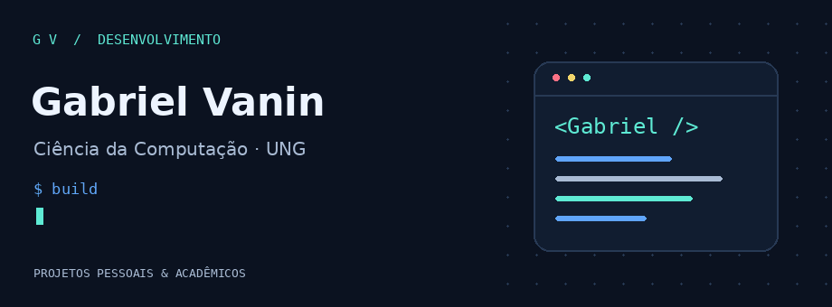
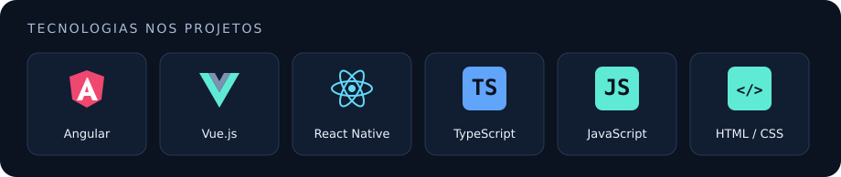
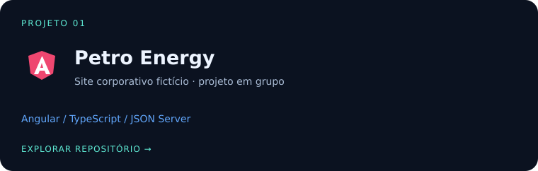
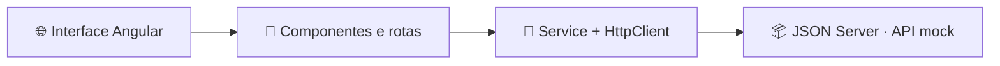
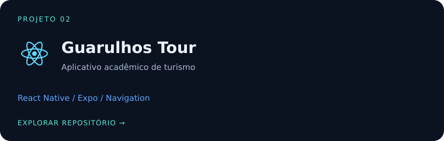
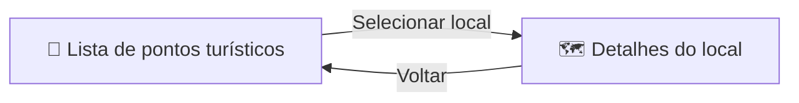
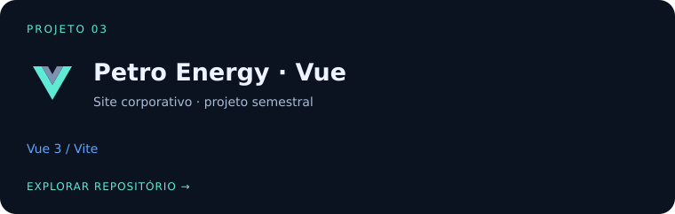
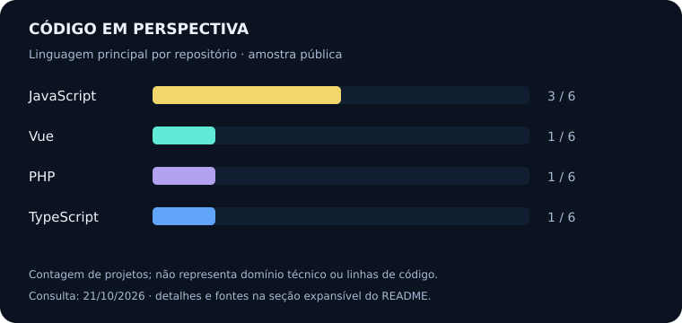

<p align="center">
  <picture>
    <source media="(prefers-reduced-motion: reduce)" srcset="assets/hero-static.png">
    
  </picture>
</p>

<h1 align="center">Olá, eu sou o Gabriel 👋</h1>

<p align="center">
  Graduando em <strong>Ciência da Computação na Universidade Guarulhos (UNG)</strong>.<br>
  Desenvolvo projetos pessoais e acadêmicos para praticar interfaces web,<br>
  componentização e navegação em aplicações web e mobile.
</p>

<p align="center">
  <a href="https://www.linkedin.com/in/gabriel-vanin-ba2142342/"></a>
  <a href="https://github.com/vaningabriel01?tab=repositories"></a>
</p>

<p align="center">
  <a href="#sobre">Sobre</a> ·
  <a href="#tecnologias">Tecnologias</a> ·
  <a href="#projetos">Projetos</a> ·
  <a href="#graficos">Gráficos</a> ·
  <a href="#conectar">Contato</a>
</p>

---

<a id="sobre"></a>
## 🧭 Construindo minha base, um projeto por vez

Meu GitHub reúne estudos e aplicações desenvolvidas durante a graduação. Entre os trabalhos estão um site corporativo fictício em **Angular**, uma versão em **Vue** e um aplicativo de turismo em **React Native**.

Gosto de organizar o aprendizado em projetos com interfaces, componentes reutilizáveis e documentação do que foi desenvolvido.

<details>
<summary><strong>⌘ Abrir meu cartão de apresentação</strong></summary>

```json
{
  "nome": "Gabriel Camargo Vanin",
  "github": "vaningabriel01",
  "formacao": "Ciência da Computação — UNG (em andamento)",
  "projetos": ["web", "mobile", "estudos acadêmicos"],
  "evidencias": ["repositórios públicos", "código", "documentação"]
}
```

</details>

<a id="tecnologias"></a>
## 🛠️ Tecnologias que aparecem nos meus projetos

<p align="center">
  
</p>

| Contexto | Aplicação nos projetos |
| :--- | :--- |
| 🌐 Web | Angular e Vue para interfaces e aplicações SPA |
| 📱 Mobile | React Native, Expo e navegação entre telas |
| 🎨 Interface | HTML, CSS, componentes e layouts responsivos |
| 🔌 Dados | Consumo de API REST simulada com JSON Server no Petro Energy |

<a id="projetos"></a>
## 🚀 Projetos para explorar

Clique nos cartões para abrir o código. Expanda as seções para conhecer o escopo de cada trabalho.

<a href="https://github.com/vaningabriel01/petro-energy"></a>

<details>
<summary><strong>🛢️ Petro Energy · ver funcionalidades e arquitetura</strong></summary>

Projeto acadêmico em grupo: uma SPA para uma empresa fictícia, com páginas institucionais, notícias, projetos sociais e busca.

- Componentes compartilhados e navegação com Angular Router.
- Comunicação HTTP com uma API mock em JSON Server.
- Páginas de detalhes e busca de conteúdo.



[Explorar código e documentação →](https://github.com/vaningabriel01/petro-energy)

</details>

<a href="https://github.com/vaningabriel01/mobile-projects"></a>

<details>
<summary><strong>📱 Guarulhos Tour · explorar o fluxo do aplicativo</strong></summary>

Aplicativo acadêmico que apresenta pontos turísticos de Guarulhos, com componentes reutilizáveis e navegação entre a listagem e os detalhes de cada local.



Os dados são locais. O login é um protótipo visual, sem autenticação; o projeto não inclui backend.

[Explorar código e documentação →](https://github.com/vaningabriel01/mobile-projects)

</details>

<a href="https://github.com/vaningabriel01/vue-project-av1"></a>

<details>
<summary><strong>💚 Petro Energy em Vue · conhecer a outra implementação</strong></summary>

Site corporativo desenvolvido com Vue como projeto semestral, apresentando a identidade de uma empresa fictícia. O repositório utiliza Vue 3 e Vite.

[Explorar a implementação em Vue →](https://github.com/vaningabriel01/vue-project-av1)

</details>

<details>
<summary><strong>📂 Abrir outros repositórios de estudo</strong></summary>

- [dev-portfolio-projects](https://github.com/vaningabriel01/dev-portfolio-projects) — projetos pessoais e acadêmicos.
- [Angular-projects](https://github.com/vaningabriel01/Angular-projects) — outra implementação acadêmica de PetroEnergy.
- [vue-projects](https://github.com/vaningabriel01/vue-projects) — repositório de estudos.
- [web_development](https://github.com/vaningabriel01/web_development) — projetos da universidade.

</details>

<a id="graficos"></a>
## 📊 Um olhar sobre os repositórios

<p align="center">
  
</p>

<details>
<summary><strong>🔎 Abrir os dados e entender o gráfico</strong></summary>

Retrato dos **seis repositórios exibidos na seção de repositórios populares** do perfil público em **21/10/2026**. A contagem usa a linguagem principal indicada pelo GitHub para cada repositório. Não é uma medida de proficiência nem um percentual das linhas de código. Esta imagem é estática.

| Repositório | Linguagem principal |
| :--- | :--- |
| dev-portfolio-projects | JavaScript |
| vue-project-av1 | Vue |
| web_development | PHP |
| vue-projects | JavaScript |
| mobile-projects | JavaScript |
| Angular-projects | TypeScript |

[Consultar o perfil e os repositórios →](https://github.com/vaningabriel01)

</details>

<a id="conectar"></a>
## 🤝 Vamos conversar?

Para conversar sobre os projetos ou trocar experiências de estudo, me encontre no [LinkedIn](https://www.linkedin.com/in/gabriel-vanin-ba2142342/).

<p align="center">
  <strong>Explore o código. Abra os detalhes. Acompanhe os próximos projetos.</strong><br>
  <a href="https://github.com/vaningabriel01?tab=repositories">Ver todos os repositórios ↗</a>
</p>
